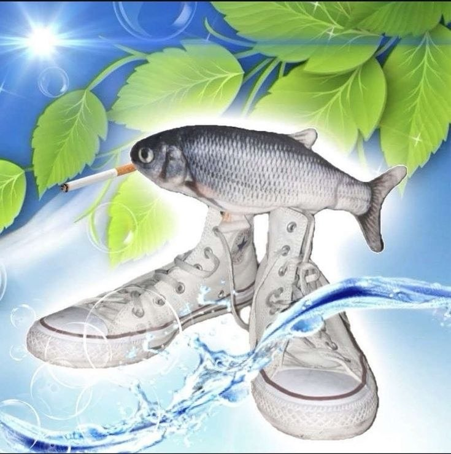

# Лабораторная работа №1
Березкина Наталья Сергеевна 6404-010302D.
Научный руководитель: Трусова Алла Юрьевна.
Примерная тема диплома: "Прогнозирование экономических показателей эконометрическим моделированием".
Любимая цитата философа: "Все, что нас не убивает, делает нас сильнее" © Ф.Ницше.
Картинка смешная (по моему мнению):

# Лабораторная работа №2.

Сайт по игре Stardew Valley: 5 страниц (`index`, `crops`, `villagers`, `seasons`, `tips`), общий файл стилей `css/style.css`, описание игры, таблица урожая, жители города Пеликан с любимыми подарками, сезоны и советы новичкам.

# Лабораторная работа №3.

JavaScript: набор функций в проекте-каркасе `js-tasks` (папка `lab3/js-tasks`, код в `src/core.js`):
проверка целого числа и степени двойки (побитовые операторы), 
сумма до n (цикл и рекурсия), 
факториал, числа Фибоначчи, 
замыкания (`getOperationFn`, `sequence`), 
глубокое сравнение объектов `deepEqual`.
Запуск тестов: `npm install`, затем `npm test`.